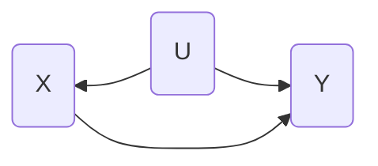

### Applied Data Analytics

 

# Data analysis — Interpretation challenges

### Graphs & Causality

 

Hans-Martin von Gaudecker and Aapo Stenhammar

---

# Graphs & Causality

- Graphs encode sense of direction

- Data description alone **never** does

---

# Inferring causality

- The introductory graphical criterion used here assumes a DAG.

  _Feedback requires a separately specified dynamic or simultaneous model._

   

- For the simple unadjusted comparisons here, rule out confounding paths:

 
 

---

# Inferring causality

- The introductory graphical criterion used here assumes a DAG.

  _A cycle prevents applying this criterion as drawn; it does not by itself prove
  that a causal effect cannot be identified._

   

- Adjustment may remove confounding if an appropriate set of confounders is observed
  and the statistical model is correctly specified.

  _For example, in a suitable multiple regression:_

  $$Y_i = \beta_0 + \beta_1 X_{1, i} + \beta_2 X_{2_i} + \ldots + \beta_k X_{k_i} + U_i$$

  _but the world is too complex for that._

 
 
 
